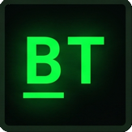

# BitText 

O **BitText** é uma aplicação web full-stack desenvolvida para consolidar conhecimentos avançados no ecossistema **.NET**, aplicando conceitos de arquitetura distribuída, separação de responsabilidades (Web API e interface) e orquestração de contêineres.

Trata-se de um jogo educativo focado em lógica computacional, onde o desafio é decodificar letras para os seus respectivos valores binários baseados na tabela ASCII (ex: `A = 0100.0001`).

## 🚀 Funcionalidades

* **Modo Partida Customizável:** O jogador pode ajustar as configurações de dificuldade antes de iniciar, alterando o tempo limite e a quantidade de vidas.
* **Modo Tutorial Offline:** Um ambiente de treinamento progressivo e livre de dependência de rede, permitindo ao usuário praticar a conversão de toda a sequência alfabética (de 'A' a 'Z' em maiúsculas) no seu próprio ritmo.
* **Validação Rápida:** O motor do jogo processa a entrada binária e valida a precisão da conversão instantaneamente.

## 🛠️ Stack Tecnológico

* **Back-end:** C#, ASP.NET Core Web API
* **Front-end:** Blazor, Tailwind CSS
* **Infraestrutura:** Docker, Docker Compose

## ⚙️ Como executar localmente

O projeto está totalmente conteinerizado. Com o Docker Desktop instalado, siga os passos:

1. Clone este repositório.
2. Abra o terminal na pasta raiz do projeto.
3. Execute o comando de orquestração:
```bash
docker compose up --build
```
4. Para acessar o site, vá para [http://localhost:5001](http://localhost:5001) e, para ver o funcionamento da API, acesse [http://localhost:5000](http://localhost:5000)
